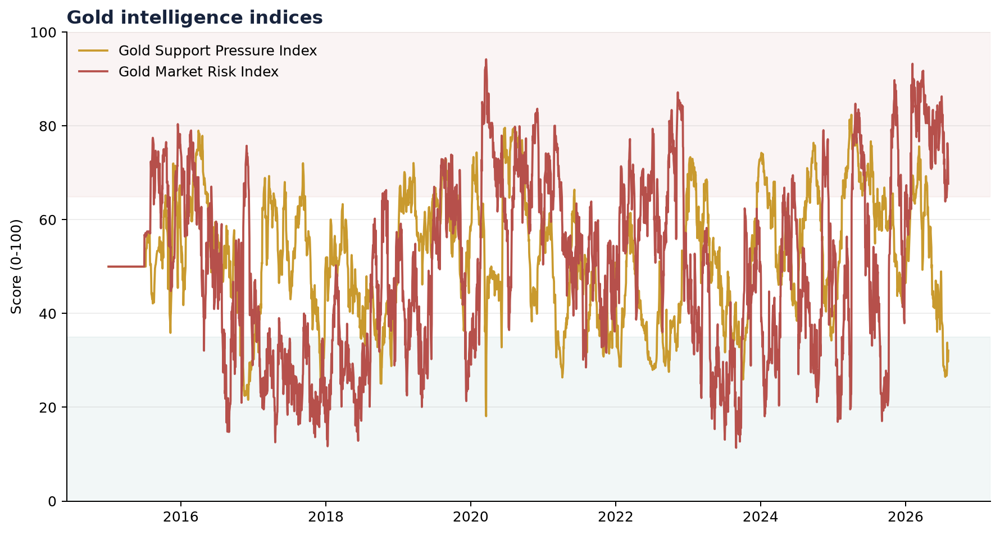

# Gold Monetary, Geopolitical & Supply Risk Intelligence Model

This project tests whether geopolitical pressure affects gold directly or is
transmitted through real yields, the U.S. dollar, inflation expectations, and
general market stress. It then measures how those conditions flow into a
gold-mining ETF and major producers.

The project is a portfolio companion to earlier energy-market work built around
the transmission question `Geopolitical Risk -> Oil -> Energy Equities`. Here,
the corresponding framework is:

`Geopolitical and monetary pressure -> Gold -> Mining equities`

## What makes the model different

It does not label every gold-positive condition as risk. It produces two
separate measures:

- **Gold Support Pressure Index:** conditions that may support gold prices.
- **Gold Market Risk Index:** volatility, drawdown, dispersion, instability,
  positioning, and supply vulnerability.

This separation allows high support and high risk to exist at the same time.



## Assets and factors

| Role | Series |
|---|---|
| Gold | Gold futures and GLD |
| Mining sector | GDX |
| Producers | Newmont, Barrick, Agnico Eagle, AngloGold Ashanti |
| Broad market | S&P 500 proxy |
| Monetary factors | 10-year real yield, broad dollar, breakeven inflation |
| Risk factors | VIX and AI Geopolitical Risk Index |
| Extensions | Central-bank purchases, CFTC positioning, USGS supply context |

## Outputs

- Performance and drawdown statistics
- Monthly gold and mining-equity factor regressions
- Gold-beta comparison across producers
- Gold Support Pressure and Gold Market Risk histories
- Eight scenario simulations with 5,000 Monte Carlo runs
- Six decision-ready charts
- Data status and source registers
- Executive PDF report
- Streamlit dashboard

The latest portfolio-facing sample is available as the
[executive PDF report](outputs/reports/gold_risk_intelligence_report.pdf).

## Quick start

```powershell
python -m venv .venv
.\.venv\Scripts\Activate.ps1
pip install -r requirements.txt
python main.py --mode auto
streamlit run app.py
```

On macOS or Linux, activate with `source .venv/bin/activate`.

### Data modes

```bash
python main.py --mode live
python main.py --mode auto
python main.py --mode demo
```

- `live` requires every core connector to succeed.
- `auto` attempts live data and falls back to clearly labeled deterministic
  demonstration data.
- `demo` is intended for tests, screenshots, and offline review. Demo results
  must never be presented as current market findings.

No API key is required for the core model.

## Project structure

```text
gold-monetary-geopolitical-risk-model/
├── app.py
├── main.py
├── config/settings.json
├── data/manual/
├── docs/
├── src/
├── tests/
└── outputs/
```

## Model governance

- Missing optional data receives a disclosed neutral score of 50.
- Every run records source coverage, data mode, dates, and model version.
- Regressions are explanatory and do not establish causation.
- Scenario results are conditional estimates rather than price forecasts.
- Scores are not standalone trading signals.

See [docs/METHODOLOGY.md](docs/METHODOLOGY.md) and
[docs/SOURCES.md](docs/SOURCES.md) for complete design and source notes.

## Testing

```bash
python -m unittest discover -s tests -v
python main.py --mode demo
```

GitHub Actions runs the unit suite and deterministic demo pipeline on Windows
and Linux with Python 3.12 and 3.14. This matrix is designed to catch both
analytical regressions and platform-specific PDF issues.

## Reproducibility

- The Monte Carlo seed, run count, index weights, and model version live in
  `config/settings.json`.
- Each run writes an output manifest with data dates, effective mode, coverage,
  and limitations.
- Live and demo results are explicitly labeled; auto-mode fallback cannot be
  mistaken for a live run.
- Generated tables and processed source data remain untracked. The six charts
  and executive report are retained as reviewable portfolio samples.

## Current development boundary

Version 0.1.1 connects the core market, monetary, volatility, and geopolitical
series. Central-bank demand can be supplied through the reviewed manual import.
CFTC positioning and annual country-level supply concentration are documented
extensions and remain neutral until their validation rules are added.

Version 0.1.1 also adds cross-platform report-font discovery for Windows,
macOS, and Linux, with a safe ReportLab core-font fallback.

See [CHANGELOG.md](CHANGELOG.md) for release details and
[CONTRIBUTING.md](CONTRIBUTING.md) for the validation workflow.

## Disclaimer

This project is for research, education, and professional portfolio
demonstration. It is not investment advice. Review each provider's terms before
redistributing or commercially deploying its data.
